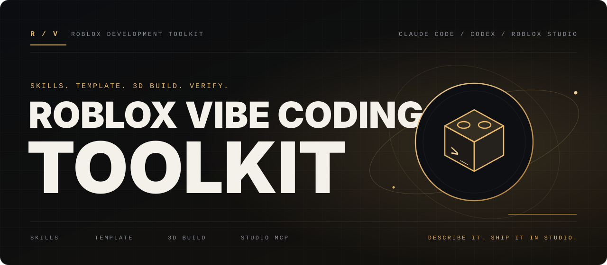
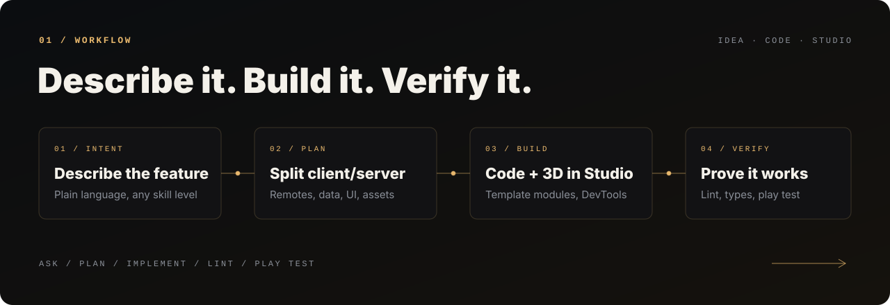
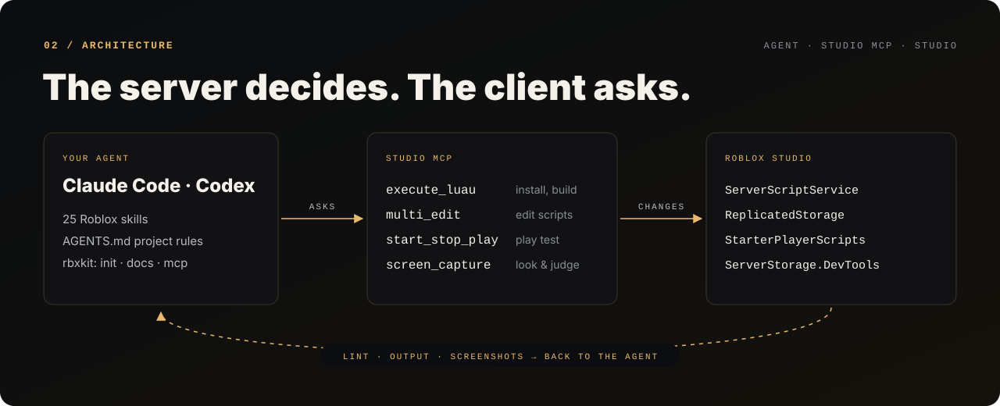
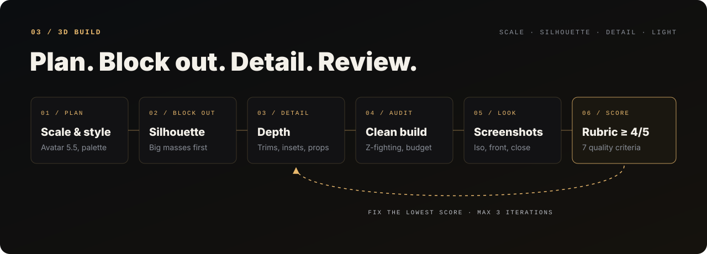

<p align="center">
  
</p>

<h1 align="center">Roblox Vibe Coding Toolkit</h1>

<p align="center">
  <b>Describe your game. Your AI agent builds it in Roblox Studio — securely, cleanly, and good-looking.</b>
</p>

<p align="center">
  <a href="#-one-prompt-setup"><b>ONE-PROMPT SETUP →</b></a> ·
  <a href="#-quick-start">QUICK START</a> ·
  <a href="#-connect-roblox-studio">CONNECT STUDIO</a> ·
  <a href="#-whats-inside">WHAT'S INSIDE</a> ·
  <a href="#-3d-building-that-looks-good">3D BUILDING</a> ·
  <a href="#-the-rbxkit-cli">RBXKIT CLI</a>
</p>

<p align="center">
  <a href="https://github.com/gustavopiumbini/robloxcodingtoolkit/actions/workflows/ci.yml"></a>
  <a href="LICENSE"></a>
  
  
</p>

<p align="center">
  <b>Claude Code</b> + <b>Codex CLI</b> / portable <code>SKILL.md</code> skills / Rojo template / Roblox Studio MCP
</p>

---

## 00 / Choose where to start

| Your situation | Path | What you get |
|---|---|---|
| **I have a game idea** | [One prompt](#-one-prompt-setup) · [manual](#1-create-a-game) | Rojo project, secure networking and data modules, 3D build tools, 26 skills, agent rules |
| **I already have a project** | [One prompt](#existing-project-one-prompt) · [manual](#existing-project) | Skills + `AGENTS.md` + `rbxkit` in your repo, nothing overwritten |
| **I want the agent inside Studio** | [Connect Studio MCP](#-connect-roblox-studio) | Your agent can play test, read Output, run Luau and take screenshots |

<p align="center">
  
</p>

You describe the goal in plain language — *"add a shop with a sword and a shield"*, *"build a medieval tavern"*, *"make an obby with 10 checkpoints"*. The agent loads only the skills it needs, plans the client/server split, writes strict Luau on top of battle-tested modules, builds geometry in Studio, then **proves it works**: lint, type check, play test, screenshots.

---

## 🚀 One-prompt setup

Open **Claude Code** or **Codex** in an empty folder and paste two lines. Replace the second line with your game:

```text
Read https://raw.githubusercontent.com/gustavopiumbini/robloxcodingtoolkit/main/docs/prompts/new-game.md and follow it.
Game: [name, genre, core loop, look & feel, monetization, target devices]
```

Example:

```text
Read https://raw.githubusercontent.com/gustavopiumbini/robloxcodingtoolkit/main/docs/prompts/new-game.md and follow it.
Game: "Candy Tycoon" — players own a candy factory, buy droppers and conveyors with coins, upgrade
machines, and rebirth for multipliers. Bright cartoon candy style, mobile-first, VIP game pass with 2x coins.
```

The agent then does everything in one go:

| Step | What the agent does |
|---|---|
| **1 / Inspect** | Checks OS, Node, Rokit, Rojo, Roblox Studio and Studio MCP — asks you **once** before installing what's missing |
| **2 / Project** | Creates the game with `rbxkit init` (template, 26 skills, `AGENTS.md`) |
| **3 / Toolchain** | `rokit install`, `rojo plugin install`, `rbxkit doctor` |
| **4 / Studio** | Starts `rojo serve` and tells you the 2 clicks to connect Rojo and Studio MCP |
| **5 / Game** | Designs the core loop, then builds servers, remotes, saved data, UI, map and props with the skills |
| **6 / Verify** | Lint, `rojo build`, play test in Studio with zero Output errors, screenshots — then a hand-over with next prompts |

If the agent has to restart (for example after you turn on Studio MCP), just say **"continue Roblox setup"**: every step detects what's already done.

<a id="existing-project-one-prompt"></a>
**Existing project?** Open the agent at your project root:

```text
Read https://raw.githubusercontent.com/gustavopiumbini/robloxcodingtoolkit/main/docs/prompts/existing-project.md and follow it.
Task: [optional — e.g. "audit everything before I publish" or "add a daily reward"]
```

It installs the toolkit without overwriting your files, adapts `AGENTS.md` to your layout and frameworks, runs a baseline audit and then does the task.

> [!TIP]
> If your agent can't open URLs (some Codex sandboxes block network), run `curl -sL <url>` yourself and paste the file, or clone this repo and point the agent at `docs/prompts/`.

---

## ⚡ Quick start

**Requirements:** [Roblox Studio](https://create.roblox.com/) · [Node.js 18+](https://nodejs.org/) · [Rokit](https://github.com/rojo-rbx/rokit) · [Claude Code](https://claude.com/claude-code) and/or [Codex CLI](https://developers.openai.com/codex)

### 1. Create a game

```bash
npx github:gustavopiumbini/robloxcodingtoolkit init MyGame
cd MyGame
rokit install     # rojo, selene, stylua, luau-lsp
rojo serve        # keep it running
```

In Studio, install the [Rojo plugin](https://rojo.space/docs/v7/getting-started/installation/), open a place and click **Connect**. Everything in `src/` now syncs live.

### 2. Talk to your agent

```bash
claude    # or: codex
```

> *Use the roblox-feature skill and add a pet system: pets follow the player and boost coins.*
>
> *Build a cozy medieval tavern next to spawn, with an interior, and review it with screenshots.*
>
> *Add a VIP Game Pass that doubles coins.*
>
> */roblox-review — audit the project before I publish.*
>
> *My game throws `attempt to index nil with 'Humanoid'`.*

In Claude Code every skill is also a slash command (`/roblox-feature`, `/roblox-3d-building`, …). In Codex, mention the skill by name or use `$roblox-feature`.

### Existing project

```bash
npx github:gustavopiumbini/robloxcodingtoolkit install path/to/your/game
```

Adds skills to `.claude/skills/` (Claude Code) and `.agents/skills/` (Codex), plus `AGENTS.md`, `CLAUDE.md` and `tools/rbxkit.mjs`. Existing `AGENTS.md`/`CLAUDE.md` are kept unless you pass `--force`. Skills assume the template's Rojo layout; adjust the *Map* section of `AGENTS.md` if yours differs. No Node? Copy `skills/*` and `agent/*.md` by hand.

---

## 🔌 Connect Roblox Studio

Studio ships a built-in MCP server. In Studio: **Assistant → ⋯ → Manage MCP Servers → Enable Studio as MCP server**, then under **Quick connect** turn on **Claude Code** and/or **Codex CLI** and restart the agent.

Manual setup (or run `node tools/rbxkit.mjs mcp`):

```bash
# Windows
claude mcp add Roblox_Studio -- cmd.exe /c %LOCALAPPDATA%\Roblox\mcp.bat
codex  mcp add Roblox_Studio -- cmd.exe /c %LOCALAPPDATA%\Roblox\mcp.bat

# macOS
claude mcp add Roblox_Studio -- /Applications/RobloxStudio.app/Contents/MacOS/StudioMCP
codex  mcp add Roblox_Studio -- /Applications/RobloxStudio.app/Contents/MacOS/StudioMCP
```

> [!IMPORTANT]
> MCP clients can read **and modify** the open place. Connect trusted clients only, and save your place before big changes.

To persist player data while testing, enable **Game Settings → Security → Enable Studio Access to API Services** (otherwise `DataService` keeps data in memory).

---

## 📦 What's inside

<p align="center">
  
</p>

| Delivery area | Contents |
|---|---|
| **Skills** (`skills/`) | 26 portable `SKILL.md` skills — loaded on demand, so they cost nothing until needed |
| **Game template** (`template/`) | Rojo project with server/client bootstraps (`Init` → `Start`), session-locked `DataService`, `Net` + `Guard` + `RateLimiter` secure remotes, `Signal`, `Trove`, example shop + HUD |
| **3D DevTools** (`template/src/dev/`) | `Build` (walls with openings, stairs, palettes, z-fighting audit, undo) and `Shots` (camera framing for screenshot reviews) |
| **Agent rules** (`agent/`) | Lean `AGENTS.md` (Codex & others) and `CLAUDE.md` (Claude Code) with non-negotiables and token-economy rules |
| **CLI** (`tools/rbxkit.mjs`) | Zero-dependency: `init`, `install`, `new`, Roblox lint (`check`), official docs lookup (`docs`), `mcp`, `doctor` |
| **Verification** (`.github/workflows/ci.yml`) | `rojo build`, **luau-lsp strict type check against the Roblox API**, Selene, Lune unit tests, CLI tests, token budget test |

### Skills

<table>
<tr><th>Workflow</th><th>Code & systems</th><th>World & feel</th><th>Platform</th></tr>
<tr valign="top">
<td>

`roblox-feature`<br>
`roblox-review`<br>
`roblox-debug`<br>
`roblox-docs`<br>
`roblox-studio-mcp`<br>
`roblox-testing`

</td>
<td>

`roblox-luau`<br>
`roblox-architecture`<br>
`roblox-networking`<br>
`roblox-datastore`<br>
`roblox-gameplay`<br>
`roblox-performance`<br>
`roblox-physics`<br>
`roblox-npc-ai`

</td>
<td>

`roblox-3d-building`<br>
`roblox-world-building`<br>
`roblox-ui`<br>
`roblox-input`<br>
`roblox-characters-animation`<br>
`roblox-audio`

</td>
<td>

`roblox-monetization`<br>
`roblox-text-chat`<br>
`roblox-teleport-matchmaking`<br>
`roblox-open-cloud`<br>
`roblox-tooling`<br>
`roblox-creator-store-security-audit`

</td>
</tr>
</table>

Eleven skills come from [EL4CTEO/roblox-skills](https://github.com/EL4CTEO/roblox-skills) and one from [AshExplained/roblox-skills](https://github.com/AshExplained/roblox-skills) (MIT) — see [THIRD_PARTY_NOTICES.md](THIRD_PARTY_NOTICES.md). Also worth a look: Roblox's official [roblox-studio-agent-plugin](https://github.com/Roblox/roblox-studio-agent-plugin) and [nonlooped/roblox-suite](https://github.com/nonlooped/roblox-suite).

---

## 🧱 3D building that looks good

<p align="center">
  
</p>

Agent-made builds usually look like "blocks placed by a bot": wrong scale, flat walls, random colors, flickering faces. The `roblox-3d-building` skill fixes that with a craft process and hard checks:

- **Correct scale** — avatar-relative reference (doors 4×7.5, ceilings 12–14, steps rise 1 / run 1.5, jump distances).
- **The right technique per shape** — parts for architecture, `generate_mesh`/vetted assets for organic shapes, MaterialVariants for custom surfaces, Terrain for landscapes.
- **Craft rules** — silhouette first, break flat surfaces (trims, insets, overhangs), one cohesive palette, 2–4 materials, deliberate lighting.
- **Automatic audit** — `Build.audit` finds z-fighting, tiny parts, unanchored parts and palette noise as cheap text, *before* spending tokens on screenshots.
- **Visual review loop** — `Shots.frame(model, "iso" | "front" | "close")` + `screen_capture`, scored on a 7-point rubric until every item is ≥ 4/5 (max 3 iterations).

```lua
local B = require(game:GetService("ServerStorage").DevTools.Build)
B.undoable("Cottage", function()                     -- one Ctrl+Z undoes the whole build
	local m = B.model("Cottage", workspace)          -- re-runnable: replaces the previous version
	B.wall(m, { from = Vector3.new(-12, 1, -9), to = Vector3.new(12, 1, -9), height = 12,
		color = B.palettes.cottage.wall, material = Enum.Material.Plaster, trim = B.palettes.cottage.trim,
		openings = { { offset = 12, width = 4, height = 7.5 }, { offset = 5, width = 4, height = 4, bottom = 3 } } })
	B.finalize(m)
end)
return B.summary(B.audit(workspace.Cottage))         -- "parts=13 meshParts=0 unanchored=0 ..."
```

---

## 🪙 Built to save tokens (without losing quality)

| Technique | Effect |
|---|---|
| Skills load on demand; only names + one-line descriptions are always in context | ~2.2k tokens per session for 26 skills + rules |
| Lean `AGENTS.md` (no duplicated skill table) + English everywhere | −38% always-loaded context vs. the first version |
| Progressive disclosure: deep recipes live in `references/` | Large tables load only for the exact case |
| `rbxkit docs --api Class:Member` returns just one member from the official docs | A few hundred tokens instead of multi-thousand-token class pages — and no hallucinated APIs |
| DevTools `Build`/`Shots` | One `B.wall{}` call instead of dozens of `Instance.new` lines; text audits before screenshots |
| A token-budget test in CI | Prevents skills and rules from silently growing |

---

## 🛠 The `rbxkit` CLI

Inside a project: `node tools/rbxkit.mjs <command>`

```text
init <dir> [--name Name]            create a new game
install [dir] [--force]             add skills/AGENTS.md to an existing project
new service|controller|module <Name>
check [paths] [--json] [--strict]   Roblox lint (exit 1 on errors)
docs "<question in English>"        search the official Roblox docs
docs --api Class[:member]           API reference (TweenService:Create, task.wait, CFrame.new)
docs --deprecated <Name>            deprecated? what replaces it?
mcp [--client claude|codex] [--os windows|mac] [--write]
doctor                              check rojo/selene/stylua/claude/codex
```

### `rbxkit check` — Roblox-aware lint

| Severity | Catches |
|---|---|
| **error** | `wait`/`spawn`/`delay`, `:connect`, `loadstring`, `require(assetId)` backdoors, `InvokeClient`, `LocalPlayer` on the server, server-only services on the client, `RenderStepped` on the server, yield-less `while true` |
| **warning** | Remote handlers without validation, `Instance.new(class, parent)`, `FireServer(player, …)`, `SetPrimaryPartCFrame`, `Humanoid:LoadAnimation`, BodyMovers, `FindPartOnRay`, `getfenv`/`setfenv`, DataStore calls without `pcall` |
| **info** | `SetAsync` (prefer `UpdateAsync`), `game.Players` without `GetService`, global `unpack`, missing `--!strict` |

Silence a line with `-- rbxkit-ignore: rule`, or the next one with `-- rbxkit-ignore-next-line`.

---

## 🗂 Template layout

```text
src/
  server/                     → ServerScriptService.Server
    init.server.luau            bootstrap: require Services/, Init() then Start()
    Config/DataTemplate.luau    saved data shape
    Services/                   DataService · CoinService · ShopService
  client/                     → StarterPlayerScripts.Client
    init.client.luau            bootstrap for Controllers/
    Controllers/HudController.luau
  shared/                     → ReplicatedStorage.Shared
    Net.luau                    named remotes with validation + rate limits
    Config/Items.luau
    Util/                       Guard · RateLimiter · Signal · Trove
  dev/                        → ServerStorage.DevTools (Studio-only tooling)
    Build.luau · Shots.luau
```

---

## 🧪 Developing the toolkit

```bash
npm test                                  # CLI, skills and token budget (node:test)
npm run check:template                    # the template must pass its own lint
lune run tests/luau/utils.spec.luau       # Guard, RateLimiter, Signal, Trove
lune run tests/luau/build.spec.luau       # Build geometry + audit (Lune Roblox datatypes)
```

CI also runs `rojo build`, a strict `luau-lsp` type check against the Roblox API definitions, and Selene.

## License

[MIT](LICENSE). Third-party skills keep their own MIT licenses — see [THIRD_PARTY_NOTICES.md](THIRD_PARTY_NOTICES.md).
